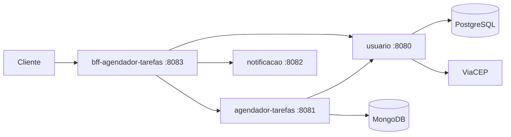

# usuario

Microsserviço de usuários do **Agendador de Tarefas**: cadastro, autenticação com JWT, endereços e telefones. A consulta de endereço por CEP usa a API pública [ViaCEP](https://viacep.com.br).

**Stack:** Java 17 · Spring Boot 3.5 · Spring Security + JWT (jjwt) · Spring Data JPA · PostgreSQL · OpenFeign · Docker Compose · GitHub Actions

## Arquitetura



Repositórios do ecossistema: [bff-agendador-tarefas](https://github.com/GabrielBarrilli/bff-agendador-tarefas) · [agendador-tarefas](https://github.com/GabrielBarrilli/agendador-tarefas) · [notificacao](https://github.com/GabrielBarrilli/notificacao)

## Endpoints

Base: `/v1/usuario`. Rotas protegidas exigem o header `Authorization: Bearer <token>`.

| Método | Rota | Descrição |
| --- | --- | --- |
| POST | `/login` | Autentica e retorna o token JWT |
| POST | `/` | Cadastra usuário |
| PUT | `/` | Atualiza os dados do usuário autenticado |
| GET | `/` | Lista usuários |
| GET | `/email?email=` | Busca usuário por e-mail |
| GET | `/endereco/{cep}` | Consulta endereço pelo CEP (ViaCEP) |
| POST | `/endereco` | Cadastra endereço do usuário autenticado |
| PUT | `/endereco?id=` | Atualiza endereço |
| POST | `/telefone` | Cadastra telefone do usuário autenticado |
| PUT | `/telefone?telefoneId=` | Atualiza telefone |
| DELETE | `/{id}` | Remove usuário por id |

## Como rodar

```bash
cp .env.example .env      # preencha as variáveis abaixo
docker compose up --build # sobe a API na porta 8080 e o PostgreSQL na 5432
```

| Variável | Descrição |
| --- | --- |
| `USUARIO_DB_URL`, `USUARIO_DB_USER`, `USUARIO_DB_PASS` | Conexão da aplicação com o banco |
| `DATABASE_NAME`, `DATABASE_USER`, `DATABASE_PASS` | Criação do container PostgreSQL |
| `JWT_SECRET` | Chave de assinatura do JWT em Base64 (mínimo 256 bits). Gere com `openssl rand -base64 32`. Deve ser a mesma usada no `agendador-tarefas` |

## Testes e CI

```bash
./gradlew test
```

Testes unitários da camada de serviço com JUnit 5 e Mockito. Todo pull request para `main` roda build e testes no GitHub Actions.
